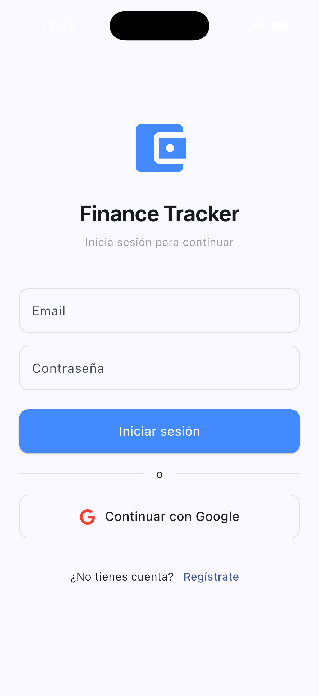
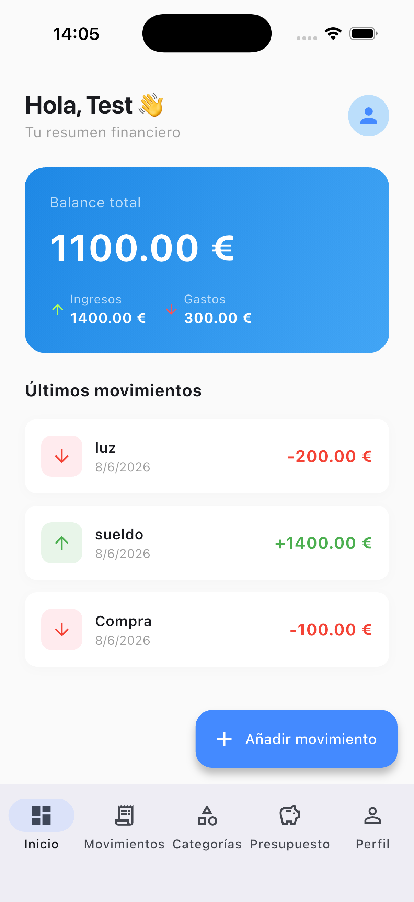
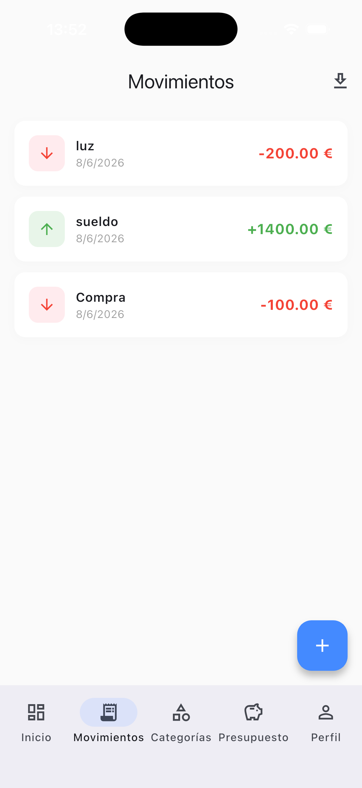
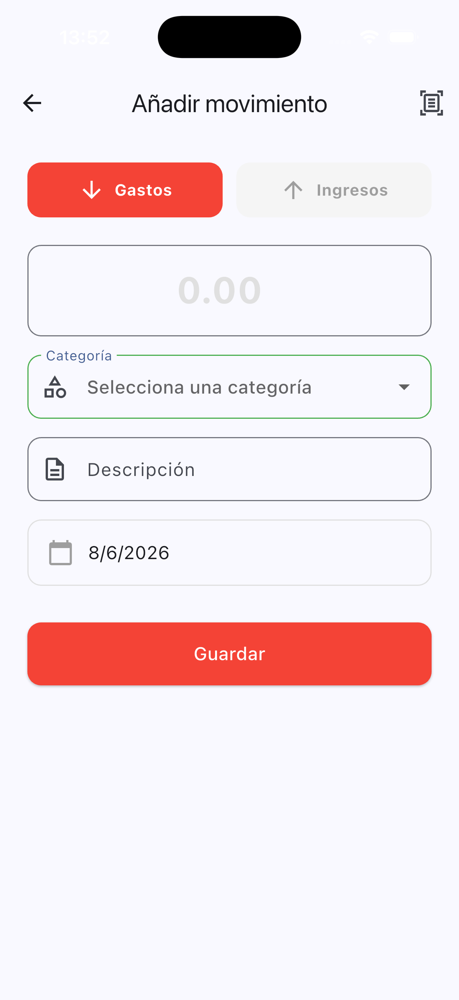
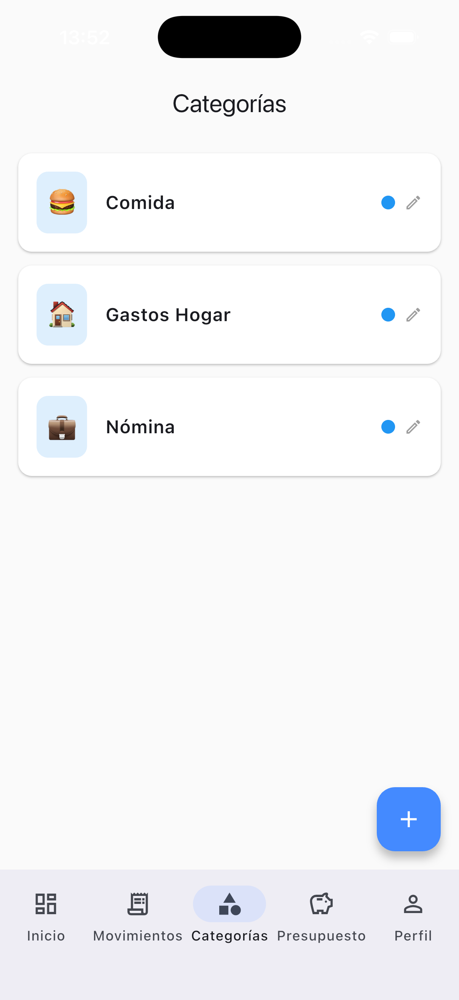
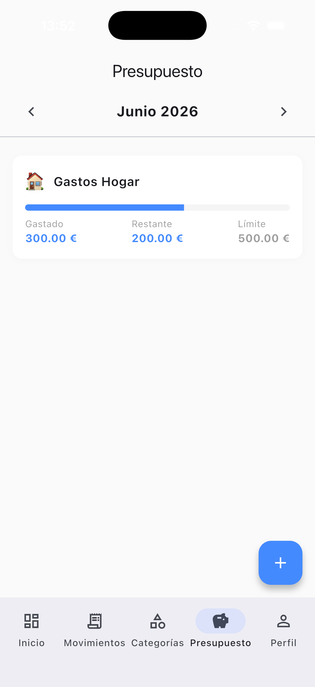
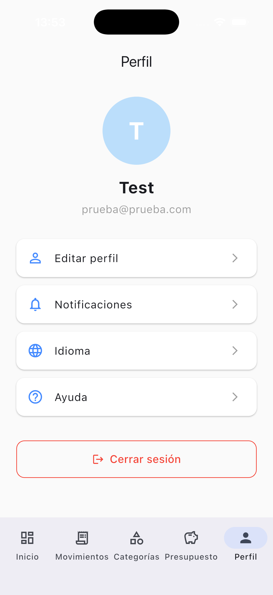

# Finance Tracker

A personal finance management app built as part of the CastroDev portfolio. Track your income, expenses, budgets, and categories with a clean and intuitive interface.

---

## 📱 Screenshots

<p align="center">
  
  
  
  
</p>
<p align="center">
  
  
  
</p>

---

## ✨ Features

- 📊 **Dashboard** — Real-time balance, income/expense summary and latest transactions
- 💸 **Transactions** — Create, view and delete transactions with category assignment
- 📁 **Categories** — Custom categories with icons and colors
- 🎯 **Budgets** — Monthly budget tracking with visual progress bars
- 📄 **Export** — Export transactions to PDF or Excel
- 📷 **OCR Scan** — Scan receipts automatically with Google Cloud Vision
- 👤 **Profile** — Edit name, manage notifications and switch language
- 🌍 **Multilingual** — English and Spanish support

---

## 🛠️ Tech Stack

| Layer | Technology |
|---|---|
| Framework | Flutter |
| State Management | Riverpod |
| Error Handling | fpdart (Either) |
| Models | Freezed + json_serializable |
| Networking | Dio |
| Authentication | Firebase Auth (Email + Google) |
| Backend | .NET 10 REST API (Clean Architecture) |
| Database | Cloud Firestore |
| Infrastructure | Google Cloud Run |

---

## 🏗️ Architecture

The app follows **Clean Architecture** per feature. Presentation depends on domain abstractions only; data implementations are wired in the Riverpod providers.

```
lib/
├── core/
│   ├── config/          # API and app configuration
│   ├── errors/          # Failure types (fpdart)
│   ├── logging/         # AppLogger (dart:developer)
│   └── network/         # Dio client with Firebase auth
└── features/
    ├── auth/            # Login, register, Google Sign-In
    ├── transactions/    # CRUD, export PDF/Excel, OCR scan
    ├── categories/      # CRUD with icon and color picker
    ├── budgets/         # Monthly budget tracking
    ├── home/            # Dashboard and navigation
    └── profile/         # Settings, notifications, language
```

Each feature follows the pattern:
```
feature/
├── data/
│   ├── datasources/     # Remote API calls
│   ├── models/          # Freezed + JSON models
│   └── repositories/    # Repository implementations
├── domain/
│   ├── entities/        # Freezed domain entities
│   ├── repositories/    # Abstract repository interfaces
│   └── usecases/        # Use cases (auth, profile, receipt scan, export)
└── presentation/
    ├── pages/           # Screen widgets
    ├── providers/       # Riverpod state notifiers
    └── widgets/         # Reusable UI components
```

---

## 🧭 Technical Decisions

- **Clean Architecture per feature.** Each feature has its own `data / domain / presentation`. The domain layer is plain Dart with no Flutter, Dio or Firebase imports, so business rules can be tested without a device.
- **Riverpod with `StateNotifier` and sealed states.** Each screen state (`Loading`, `Loaded`, `Error`) is an explicit type, so the UI cannot read data that is not there. The providers are the single place where concrete implementations are wired, which also makes them easy to replace in tests.
- **`Either<Failure, T>` instead of exceptions.** Repositories catch infrastructure errors, log them with `AppLogger` and return a `Failure`. The notifiers and pages only fold the result.
- **Freezed for entities and failures.** Immutable values with equality for free, and a sealed `Failure` that forces exhaustive handling.
- **Use cases only where they add something.** Auth, profile, receipt scan and export have use cases. Plain CRUD (transactions, categories, budgets) goes from the notifier straight to the repository to avoid empty pass-through classes. The trade-off is that the rule is not uniform across features.
- **Shared .NET 10 API.** Business rules and OCR live on the server; the app sends the Firebase ID token through a Dio client. One backend serves all the apps in this portfolio.
- **Tests with hand-written fakes.** The notifiers, use cases and repository mappings are covered with fakes of the domain interfaces, with no mocking library.

### Other projects in this portfolio

| Project | Platform | Language |
|---|---|---|
| [finance-tracker](https://github.com/gcalvarez93/finance-tracker) | Flutter (iOS + Android) | Dart |
| [habit-tracker](https://github.com/gcalvarez93/habit-tracker) | Flutter (iOS + Android) | Dart |
| [task-manager](https://github.com/gcalvarez93/task-manager) | iOS | Swift |
| [budget-scanner](https://github.com/gcalvarez93/budget-scanner) | iOS | Swift |
| [recipe-manager](https://github.com/gcalvarez93/recipe-manager) | Android | Kotlin |
| [workout-tracker](https://github.com/gcalvarez93/workout-tracker) | Android | Kotlin |
| [castrodev-api](https://github.com/gcalvarez93/castrodev-api) | Shared backend | C# (.NET 10) |

---

## 🚀 Getting Started

### Prerequisites

- Flutter SDK
- Firebase project configured
- API running at `api.castrodev.com` or locally

### Installation

```bash
# Clone the repository
git clone https://github.com/gcalvarez93/finance-tracker.git

# Install dependencies
flutter pub get

# Generate code
dart run build_runner build --delete-conflicting-outputs
flutter gen-l10n

# Run the app
flutter run --dart-define=API_URL=https://api.castrodev.com

# Run the tests
flutter test
```

---

## 🔗 Related

- [CastroDev API](https://github.com/gcalvarez93/castrodev-api) — Shared .NET 10 backend

---

## 📄 License

MIT © Gabriel Castro

---

---

# Finance Tracker

Aplicación de gestión de finanzas personales desarrollada como parte del portfolio de CastroDev. Controla tus ingresos, gastos, presupuestos y categorías con una interfaz limpia e intuitiva.

---

## ✨ Funcionalidades

- 📊 **Dashboard** — Balance en tiempo real, resumen de ingresos/gastos y últimos movimientos
- 💸 **Movimientos** — Crear, ver y eliminar transacciones con asignación de categoría
- 📁 **Categorías** — Categorías personalizadas con iconos y colores
- 🎯 **Presupuestos** — Seguimiento mensual con barras de progreso
- 📄 **Exportación** — Exporta movimientos a PDF o Excel
- 📷 **Escaneo OCR** — Escanea facturas automáticamente con Google Cloud Vision
- 👤 **Perfil** — Edita tu nombre, gestiona notificaciones y cambia el idioma
- 🌍 **Multiidioma** — Soporte para español e inglés

---

## 🛠️ Stack Tecnológico

| Capa | Tecnología |
|---|---|
| Framework | Flutter |
| Estado | Riverpod |
| Manejo de errores | fpdart (Either) |
| Modelos | Freezed + json_serializable |
| Red | Dio |
| Autenticación | Firebase Auth (Email + Google) |
| Backend | API REST .NET 10 (Clean Architecture) |
| Base de datos | Cloud Firestore |
| Infraestructura | Google Cloud Run |

---

## 🧭 Decisiones Técnicas

- **Clean Architecture por feature.** Cada feature tiene su propio `data / domain / presentation`. La capa de dominio es Dart puro, sin imports de Flutter, Dio ni Firebase, así que las reglas de negocio se prueban sin dispositivo.
- **Riverpod con `StateNotifier` y estados sellados.** Cada estado de pantalla (`Loading`, `Loaded`, `Error`) es un tipo explícito, y la UI no puede leer datos que no existen. Los providers son el único sitio donde se enlazan las implementaciones concretas, lo que también facilita sustituirlas en los tests.
- **`Either<Failure, T>` en lugar de excepciones.** Los repositorios capturan los errores de infraestructura, los registran con `AppLogger` y devuelven un `Failure`. Los notifiers y las páginas solo procesan el resultado.
- **Freezed para entidades y fallos.** Valores inmutables con igualdad gratis y un `Failure` sellado que obliga a tratar todos los casos.
- **Casos de uso solo donde aportan.** Auth, perfil, escaneo de tickets y exportación tienen casos de uso. El CRUD simple (movimientos, categorías, presupuestos) va del notifier directo al repositorio, para evitar clases que solo reenvían la llamada. El inconveniente es que la regla no es uniforme entre features.
- **API compartida en .NET 10.** Las reglas de negocio y el OCR viven en el servidor; la app envía el token de Firebase mediante un cliente Dio. Un solo backend sirve a todas las apps de este portfolio.
- **Tests con fakes escritos a mano.** Los notifiers, casos de uso y mapeos de repositorios están cubiertos con fakes de las interfaces del dominio, sin librería de mocks.

### Otros proyectos del portfolio

| Proyecto | Plataforma | Lenguaje |
|---|---|---|
| [finance-tracker](https://github.com/gcalvarez93/finance-tracker) | Flutter (iOS + Android) | Dart |
| [habit-tracker](https://github.com/gcalvarez93/habit-tracker) | Flutter (iOS + Android) | Dart |
| [task-manager](https://github.com/gcalvarez93/task-manager) | iOS | Swift |
| [budget-scanner](https://github.com/gcalvarez93/budget-scanner) | iOS | Swift |
| [recipe-manager](https://github.com/gcalvarez93/recipe-manager) | Android | Kotlin |
| [workout-tracker](https://github.com/gcalvarez93/workout-tracker) | Android | Kotlin |
| [castrodev-api](https://github.com/gcalvarez93/castrodev-api) | Backend compartido | C# (.NET 10) |

---

## 🚀 Instalación

```bash
# Clonar el repositorio
git clone https://github.com/gcalvarez93/finance-tracker.git

# Instalar dependencias
flutter pub get

# Generar código
dart run build_runner build --delete-conflicting-outputs
flutter gen-l10n

# Ejecutar
flutter run --dart-define=API_URL=https://api.castrodev.com

# Ejecutar los tests
flutter test
```

---

## 🔗 Relacionado

- [CastroDev API](https://github.com/gcalvarez93/castrodev-api) — Backend compartido en .NET 10

---

## 📄 Licencia

MIT © Gabriel Castro
